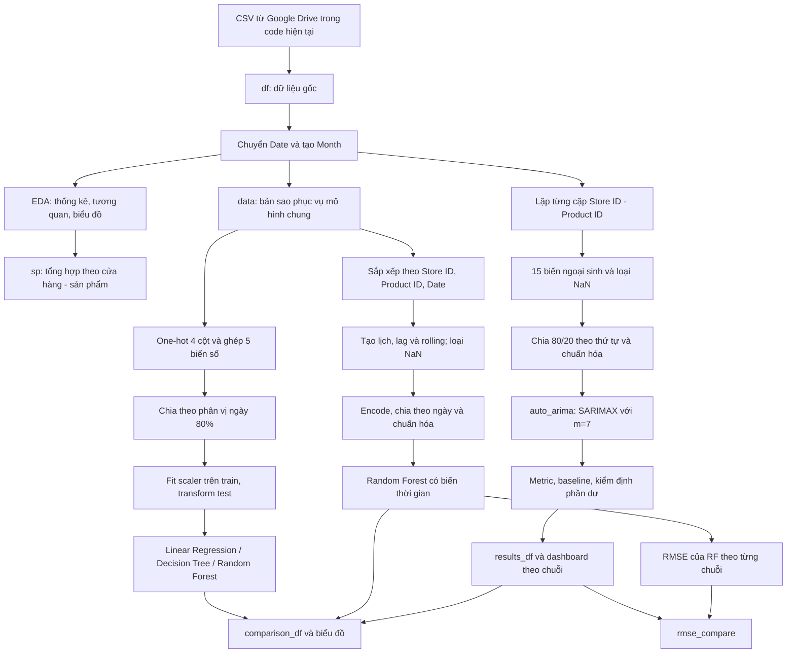

# Data pipeline — Dự báo nhu cầu bán lẻ

Tài liệu mô tả luồng xử lý hiện có trong [`source_code.ipynb`](source_code.ipynb), từ dữ liệu CSV đến đánh giá mô hình. Đây là tài liệu kiến trúc và cách dữ liệu đi qua notebook; chưa phải chương trình pipeline độc lập hoặc tác vụ chạy theo lịch.

## 1. Luồng tổng thể



CSV cục bộ có thể thay thế đầu vào Google Drive bằng cách sửa cell đọc dữ liệu như trong [README](README.md#cách-chạy). Notebook không có cơ chế tự động chuyển sang CSV khi tải từ Drive thất bại.

## 2. Đọc và kiểm tra dữ liệu

**Đầu vào:** CSV gồm 15 cột, mỗi dòng là quan sát bán hàng của một cặp cửa hàng–sản phẩm trong một ngày.

**Xử lý trong notebook:**

1. Tạo URL tải CSV từ đường dẫn chia sẻ Google Drive.
2. Đọc bằng `pd.read_csv()` vào `df`.
3. Xem `info()`, `head()` và `describe(include='all')`.
4. Chuyển `Date` bằng `pd.to_datetime()`.
5. Tạo `Month = Date.dt.month`.

**Đầu ra:** `df`, giữ các cột gốc và bổ sung `Month`.

CSV hiện tại gồm 73.100 dòng, 100 chuỗi và 731 ngày cho mỗi chuỗi, từ 01/01/2022 đến 01/01/2024. Kiểm tra CSV khi viết tài liệu không phát hiện ô trống hoặc trùng khóa ngày–cửa hàng–sản phẩm. Notebook hiện chưa tự động kiểm tra các điều kiện này, chưa tái lập lịch ngày bị thiếu và chưa có bước xử lý ngoại lệ hoặc khử trùng dữ liệu đầu vào.

## 3. Khám phá và tổng hợp

Notebook tạo bảng `sp` theo `Store ID` và `Product ID`:

| Biến | Cách tính | Mục đích |
| --- | --- | --- |
| `total` | Tổng `Units Sold` trên toàn kỳ | Xếp hạng bán chạy / bán chậm |
| `avg` | Trung bình `Units Sold` mỗi ngày | So sánh mức bán |
| `std` | Độ lệch chuẩn `Units Sold` | Đo độ biến động |
| `seasonal_std` | Độ lệch chuẩn của 12 mức bán trung bình theo tháng trong năm | Chọn chuỗi có khác biệt giữa các tháng lớn nhất |

`seasonal_std` gộp cùng tháng của các năm với nhau. Chỉ số này mô tả biến động giữa các tháng, chưa phải kiểm định chứng minh có mùa vụ.

Output đã lưu xác định:

- Bán chạy nhất: `S005`–`P0015`, tổng 109.099 sản phẩm.
- Bán chậm nhất: `S003`–`P0003`, tổng 92.556 sản phẩm.
- `seasonal_std` lớn nhất: `S003`–`P0003`, khoảng 21,62.

Notebook vẽ chuỗi bán hàng, phân bố, quan hệ giữa các biến và ma trận tương quan. File `store_product_analysis.png` là hình được lưu ra đĩa; các biểu đồ khác chủ yếu hiển thị trực tiếp.

## 4. Nhánh mô hình chung với đặc trưng gốc

**Đầu vào:** `data = df.copy(deep=True)`.

### Tạo X và y

- One-hot encoding: `Category`, `Region`, `Weather Condition`, `Seasonality`.
- Biến số: `Inventory Level`, `Price`, `Discount`, `Holiday/Promotion`, `Units Ordered`.
- Mục tiêu: `y = data['Units Sold']`.

Với danh mục của CSV hiện tại, bốn cột phân loại tạo 17 cột one-hot; tổng đầu vào là 22 đặc trưng. `Store ID`, `Product ID`, `Demand Forecast` và `Competitor Pricing` không có trong X của nhánh này.

### Chia tập và chuẩn hóa

```python
split_date = data['Date'].quantile(0.8)
train_mask = data['Date'] <= split_date
test_mask = data['Date'] > split_date

scaler = StandardScaler()
X_train = scaler.fit_transform(X[train_mask])
X_test = scaler.transform(X[test_mask])
```

Output đã lưu: **58.500 dòng train**, **14.600 dòng test**, mốc chia **08/08/2023**. Do giữ các dòng cùng ngày ở cùng một phía, tỷ lệ số dòng không nhất thiết đúng 80/20 tuyệt đối.

Encoder hiện được fit trên toàn bộ `data` trước khi chia; scaler chỉ fit trên train.

### Huấn luyện và đánh giá

Ba mô hình dùng chung tập train/test:

| Mô hình | Cấu hình |
| --- | --- |
| Linear Regression | Mặc định |
| Decision Tree | `max_depth=5`, `random_state=42` |
| Random Forest | `n_estimators=100`, `max_depth=10`, `random_state=42` |

**Đầu ra:** dự đoán train/test; MAE, MSE, RMSE, R², MAPE; biểu đồ dự đoán và phần dư. Các metric được thêm vào `model_comparison_data`; cặp giá trị thực tế–dự đoán được lưu trong `actual_vs_predicted_data`.

## 5. Nhánh Random Forest có biến thời gian

**Đầu vào:** bản sao `data`, được sắp xếp theo `Store ID`, `Product ID`, `Date`.

### Đặc trưng bổ sung

| Biến | Cách tạo |
| --- | --- |
| `DayOfWeek` | Thứ trong tuần, từ 0 đến 6 |
| `Month` | Tháng trong năm |
| `IsWeekend` | 1 nếu thứ Bảy / Chủ nhật |
| `DayOfMonth` | Ngày trong tháng |
| `lag_1` | `Units Sold` của quan sát trước trong cùng chuỗi |
| `lag_7` | `Units Sold` cách 7 quan sát trong cùng chuỗi |
| `rolling_mean_7` | Trung bình 7 quan sát sau khi dịch mục tiêu 1 bước |
| `rolling_mean_14` | Trung bình 14 quan sát sau khi dịch mục tiêu 1 bước |

Trên dữ liệu đầy đủ mỗi ngày, một quan sát tương ứng một ngày. Việc dùng `shift(1)` giúp rolling không sử dụng mục tiêu của chính dòng đang dự đoán.

Chi tiết triển khai hiện tại: `shift()` được thực hiện theo nhóm cửa hàng–sản phẩm, sau đó `.rolling()` được gọi trên Series đã ghép. Với CSV hiện tại, các giá trị NaN đầu mỗi nhóm làm những cửa sổ ở ranh giới nhóm bị loại. Khi phát triển code, nên tính rolling hoàn toàn trong từng nhóm bằng `transform()` để quy tắc nhóm được thể hiện rõ và bền vững hơn.

### Huấn luyện

1. Loại các dòng thiếu lag / rolling.
2. One-hot bốn cột phân loại như nhánh gốc.
3. Ghép 5 biến số gốc và 8 biến mới, tổng cộng 30 đặc trưng với CSV hiện tại.
4. Tính lại phân vị ngày 80% trên dữ liệu còn lại.
5. Fit scaler trên train, transform test.
6. Huấn luyện RF với 100 cây, `max_depth=10`, `random_state=42`.

Output đã lưu: **71.700 dòng** sau khi tạo đặc trưng; **57.400 dòng train**, **14.300 dòng test**; mốc chia **11/08/2023**.

Notebook còn huấn luyện lại một RF không có lag / lịch trên chính tập dữ liệu này để đối chiếu tác động của đặc trưng thời gian. Kết quả của lần huấn luyện lại nằm trong bảng `comparison`, khác với RF gốc trong bảng tổng hợp `comparison_df`.

## 6. Nhánh SARIMAX theo từng chuỗi

**Đầu vào:** `df`, không sử dụng bản `data` đã bị loại dòng trong nhánh RF.

### Chuẩn bị từng cặp cửa hàng–sản phẩm

1. Lọc một cặp, sắp xếp ngày và đặt `Date` làm index.
2. Bỏ qua chuỗi có ít hơn 60 dòng ban đầu.
3. Chuyển `Weather Condition` và `Seasonality` sang mã danh mục trong từng chuỗi.
4. Tạo `y = Units Sold` và 15 biến ngoại sinh.

| Nhóm | Tên biến trong X của SARIMAX |
| --- | --- |
| Vận hành và thương mại | `Inventory`, `Units Ordered`, `Price`, `Discount`, `Promotion`, `Competitor Price` |
| Bối cảnh | `Weather`, `Seasonality` |
| Lịch | `DayOfWeek`, `Month`, `Weekend` |
| Lịch sử bán hàng | `Lag1`, `Lag7`, `MA7`, `MA14` |

`MA7` và `MA14` được tính từ `y.shift(1)` trong chính chuỗi đó. Ghép y và X, loại NaN; bỏ qua nếu còn ít hơn 50 dòng.

### Chia tập và chọn mô hình

- Chia theo vị trí: `split = int(len(sx_data) * 0.8)`.
- Lấy 80% đầu làm train, phần còn lại làm test.
- Fit `StandardScaler` trên `train_X`, transform `test_X`.
- Chạy `auto_arima` với biến ngoại sinh và cấu hình:

```python
start_p=0, start_q=0, max_p=5, max_q=5
d=None, D=None
seasonal=True, m=7
start_P=0, start_Q=0, max_P=2, max_Q=2
test="adf", information_criterion="aic", stepwise=True
```

`m=7` là chu kỳ tuần ứng viên trong tìm kiếm; mô hình được chọn có thể có các hệ số AR / MA bằng 0. Không nên mặc định mọi chuỗi đều có thành phần mùa vụ có ý nghĩa.

Với dữ liệu hiện tại, mỗi chuỗi còn **717 dòng**, chia **573 train / 144 test**. Notebook lưu output huấn luyện thành công cho 100 chuỗi.

### Đánh giá và baseline

| Thành phần | Cách tính / ý nghĩa |
| --- | --- |
| MAE, RMSE, R² | Đánh giá dự đoán trên test của từng chuỗi |
| MAPE | Bỏ `y_true = 0`, tính tỷ lệ phần trăm |
| MASE | MAE test chia cho trung bình sai phân tuyệt đối một bước trên train |
| Naive | Lặp lại giá trị cuối của train cho toàn bộ test |
| Seasonal Naive | Lặp lại 7 giá trị cuối của train cho toàn bộ test |
| Cải thiện so với baseline | `(MAE_baseline - MAE_model) / MAE_baseline * 100` |
| Ljung–Box | Kiểm tra tự tương quan phần dư test ở các lag 1–10, ngưỡng 0,05 |
| Jarque–Bera | Kiểm tra phân phối chuẩn của phần dư test, ngưỡng 0,05 |

`MASE < 1` cho biết MAE test thấp hơn thang sai số một bước trong train; tỷ lệ thắng baseline trên test được tính riêng. Cờ `Diagnostics_Pass` kết hợp hai kiểm định; code hiện coi kiểm định không trả được kết quả là không làm mô hình thất bại, nên đây không phải chứng nhận chất lượng vận hành.

Lỗi trong khối fit / predict / đánh giá của một chuỗi được in ra và bỏ qua để vòng lặp tiếp tục. Các bước chuẩn bị trước khối `try` chưa được bao phủ bởi cơ chế này.

## 7. Tổng hợp và lưu kết quả

| Đầu ra | Nội dung | Vị trí |
| --- | --- | --- |
| `sp` | Tổng hợp mức bán và biến động theo tháng | Bộ nhớ / output notebook |
| `comparison_df` | MAE, RMSE, R² của 5 cấu hình | Bộ nhớ / output notebook |
| `results_df` | Tham số SARIMAX, metric, kiểm định, baseline và kích thước tập | Bộ nhớ / output notebook |
| `dashboard_data` | Chuỗi train/test và dự đoán cho `S005`–`P0015`, `S003`–`P0003` | Bộ nhớ |
| `rmse_compare` | RMSE của RF có biến thời gian và SARIMAX theo từng cặp | Bộ nhớ / biểu đồ |
| `store_product_analysis.png` | Biểu đồ các chuỗi đại diện | Thư mục làm việc khi chạy |

Các metric SARIMAX trong bảng tổng hợp là trung bình không trọng số của metric từng chuỗi. Các mô hình chung được đánh giá trên toàn bộ các dòng test của chúng. Đặc biệt, trung bình RMSE / R² theo chuỗi khác với RMSE / R² tính trên dữ liệu gộp.

Notebook chưa có bước xuất CSV / Excel, lưu model, lưu encoder / scaler, hoặc quản lý phiên bản dữ liệu và lần chạy. Những file Excel đang có trong thư mục không được code hiện tại tự động ghi ra.

## 8. Quy tắc đọc kết quả và phát triển tiếp

**Thông tin lịch sử trong test.** RF có biến thời gian và SARIMAX tạo lag / rolling từ cả chuỗi trước khi chia tập. Vì vậy, các dự đoán về sau trong test có sử dụng mục tiêu thực tế trước đó của test qua X. SARIMAX gọi dự đoán cả đoạn test với X đã chuẩn bị sẵn. Để dự báo nhiều ngày tại một thời điểm duy nhất, cần tạo lag / rolling đệ quy hoặc thiết kế mô hình theo từng chân trời, thay vì dùng doanh số chưa xảy ra.

**So sánh baseline.** Naive và Seasonal Naive chỉ sử dụng train, còn SARIMAX có thêm biến ngoại sinh của test và đặc trưng lịch sử cập nhật bằng doanh số thật. Phần trăm cải thiện đã lưu phản ánh thiết kế này. Muốn so sánh trong bối cảnh cập nhật từng ngày, cần cho baseline cập nhật lịch sử tương ứng.

**So sánh mô hình.** Ba mô hình gốc, RF thời gian và SARIMAX có các cửa sổ test khác nhau. Bảng RMSE theo chuỗi giúp quan sát khác biệt giữa các cặp nhưng chưa loại bỏ khác biệt ngày test. Lần đánh giá tiếp theo nên dùng cùng lịch ngày và cùng tập dòng ở mọi mô hình.

**Khả năng tái chạy.** Nên fit encoder trên train, bổ sung kiểm tra khóa và lịch ngày, định nghĩa chính xác thời điểm các biến đầu vào có sẵn, khóa phiên bản thư viện, và lưu metric kèm cấu hình. Nếu triển khai tự động, có thể tách notebook thành các bước đọc dữ liệu → kiểm tra → tạo đặc trưng → huấn luyện → đánh giá → xuất kết quả; đây là hướng phát triển, chưa phải chức năng hiện có.
