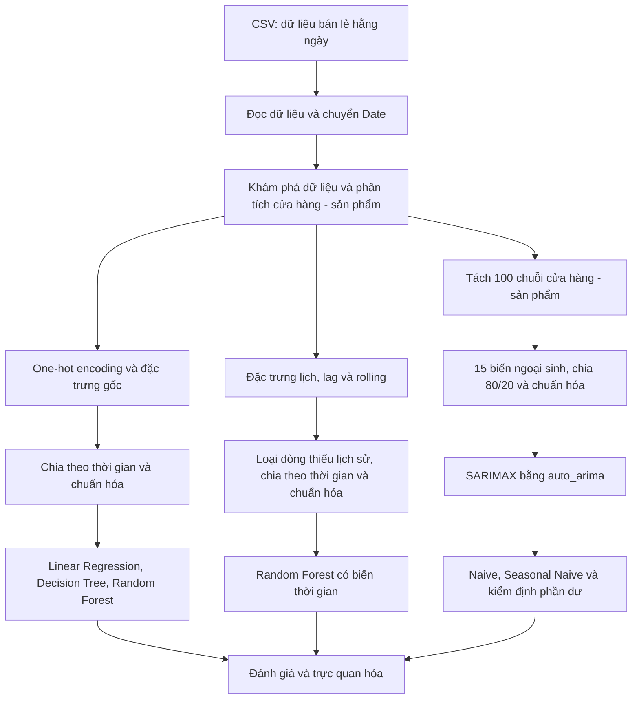

# Dự báo nhu cầu bán lẻ - Retail Store Inventory

Phân tích dữ liệu bán hàng hằng ngày và so sánh các mô hình dự báo `Units Sold` cho từng cặp cửa hàng–sản phẩm. Dự án sử dụng hồi quy, mô hình cây và SARIMAX để đánh giá mức độ dự đoán doanh số, đồng thời đối chiếu với các phương pháp dự báo đơn giản.

Đây là dự án phân tích và thử nghiệm mô hình trong Jupyter Notebook. Kết quả có thể làm cơ sở nghiên cứu cho bài toán lập kế hoạch tồn kho; notebook hiện chưa tính điểm đặt hàng, tồn kho an toàn hoặc chi phí thiếu hàng.

## Mục tiêu

- Khám phá đặc điểm bán hàng theo cửa hàng, sản phẩm, nhóm hàng và khu vực.
- Xác định các cặp cửa hàng–sản phẩm bán chạy, bán chậm và có độ biến động theo tháng cao.
- So sánh Linear Regression, Decision Tree, Random Forest và SARIMAX.
- Đánh giá ảnh hưởng của đặc trưng lịch, độ trễ và trung bình trượt.
- Kiểm tra sai số, phần dư và hiệu quả so với Naive / Seasonal Naive.

## Dữ liệu

File dữ liệu đi kèm: [`retail_store_inventory.csv`](retail_store_inventory.csv).

| Thuộc tính | Giá trị trong CSV hiện tại |
| --- | --- |
| Số dòng | 73.100 |
| Số cột gốc | 15 |
| Khoảng thời gian | 01/01/2022–01/01/2024 |
| Cửa hàng / sản phẩm | 5 / 20 |
| Số chuỗi cửa hàng–sản phẩm | 100 |
| Độ dài mỗi chuỗi | 731 ngày |
| Đơn vị quan sát | Một cửa hàng × một sản phẩm × một ngày |
| Biến mục tiêu | `Units Sold` |

Kiểm tra trực tiếp CSV hiện tại cho thấy không có ô trống và không trùng khóa `Date`–`Store ID`–`Product ID`. Đây là kết quả kiểm tra của bản dữ liệu này; notebook chưa có bộ kiểm tra dữ liệu tự động đầy đủ.

Các nhóm trường chính:

| Nhóm | Các cột |
| --- | --- |
| Thời gian và định danh | `Date`, `Store ID`, `Product ID` |
| Phân loại | `Category`, `Region`, `Weather Condition`, `Seasonality` |
| Bán hàng và tồn kho | `Units Sold`, `Inventory Level`, `Units Ordered` |
| Giá và khuyến mại | `Price`, `Discount`, `Holiday/Promotion`, `Competitor Pricing` |
| Dự báo có sẵn trong dữ liệu | `Demand Forecast` |

`Demand Forecast` không được sử dụng làm đầu vào cho các mô hình trong notebook. `Competitor Pricing` được sử dụng trong nhánh SARIMAX, nhưng không có trong đầu vào của các mô hình hồi quy / Random Forest.

Notebook hiện đọc dữ liệu qua đường dẫn Google Drive được khai báo trong code. CSV đi kèm có thể dùng để chạy cục bộ theo hướng dẫn bên dưới. Nguồn phát hành ban đầu và giấy phép sử dụng bộ dữ liệu chưa được xác định trong tài liệu này.

## Quy trình xử lý



Chi tiết đầu vào, biến trung gian, cách chia dữ liệu và các giới hạn đánh giá được mô tả trong [`DATA_PIPELINE.md`](DATA_PIPELINE.md).

## Các mô hình

| Mô hình | Cấu hình chính | Phạm vi huấn luyện |
| --- | --- | --- |
| Linear Regression | Cấu hình mặc định của scikit-learn | Một mô hình chung |
| Decision Tree | `max_depth=5`, `random_state=42` | Một mô hình chung |
| Random Forest | `n_estimators=100`, `max_depth=10`, `random_state=42` | Một mô hình chung |
| Random Forest có biến thời gian | Cùng cấu hình RF, bổ sung lịch, lag và rolling | Một mô hình chung |
| SARIMAX | `auto_arima`, chu kỳ tuần `m=7`, chọn theo AIC | Một mô hình cho mỗi cặp cửa hàng–sản phẩm |

Các mô hình chung sử dụng dữ liệu gộp của tất cả cửa hàng–sản phẩm, nhưng không đưa trực tiếp `Store ID` và `Product ID` vào tập đặc trưng. SARIMAX huấn luyện riêng từng chuỗi với 15 biến ngoại sinh.

## Kết quả đã lưu trong notebook

Các con số dưới đây được lấy từ output có sẵn trong `source_code.ipynb`, chưa được tái huấn luyện khi viết tài liệu. MAE và RMSE có đơn vị là số lượng sản phẩm bán ra; giá trị thấp hơn tốt hơn. R² cao hơn tốt hơn.

| Mô hình | MAE | RMSE | R² |
| --- | ---: | ---: | ---: |
| Linear Regression | 68,6463 | 87,6590 | 0,3442 |
| Decision Tree | 68,6998 | 87,8002 | 0,3421 |
| Random Forest | 68,8408 | 87,9636 | 0,3396 |
| Random Forest có biến thời gian | 68,8843 | 88,0066 | 0,3387 |
| SARIMAX — trung bình theo cặp cửa hàng–sản phẩm | 70,0322 | 88,9779 | 0,3101 |

Linear Regression có MAE và RMSE thấp nhất trong bảng đã lưu. Tuy nhiên, bảng này kết hợp các cửa sổ test và cách tổng hợp khác nhau: ba mô hình đầu được chia tại ngày 08/08/2023; RF có biến thời gian được chia tại ngày 11/08/2023 sau khi loại dòng thiếu lịch sử; SARIMAX chia 80/20 riêng từng chuỗi. Vì vậy, bảng thể hiện kết quả thử nghiệm hiện tại và chưa đủ để kết luận mô hình nào tốt nhất trên cùng một thiết kế đánh giá.

Trong phép so sánh riêng ở notebook, hai phiên bản RF được huấn luyện lại trên cùng tập dữ liệu và cùng mốc chia: RMSE giảm từ **88,0142** xuống **88,0066** khi thêm đặc trưng thời gian. Mức cải thiện quan sát được rất nhỏ.

Kết quả SARIMAX đã lưu:

- Huấn luyện thành công **100/100** cặp cửa hàng–sản phẩm.
- MASE trung bình: **0,5838**.
- Giảm MAE trung bình **35,70%** so với Naive và **41,26%** so với Seasonal Naive.
- Có MAE thấp hơn cả hai baseline trên **100/100** chuỗi trong phép đánh giá hiện tại.
- **79/100** mô hình được notebook gắn cờ đạt kiểm tra phần dư.

Các kết quả so với baseline cần được đọc cùng giới hạn về thông tin đầu vào ở phần tiếp theo.

## Cách chạy

### 1. Chuẩn bị môi trường

Output cài đặt đã lưu trong notebook cho thấy môi trường Python 3.12. Có thể tạo môi trường riêng bằng phiên bản này:

```bash
python -m venv .venv
```

Kích hoạt trên Windows PowerShell:

```powershell
.\.venv\Scripts\Activate.ps1
```

Hoặc trên macOS / Linux:

```bash
source .venv/bin/activate
```

Cài thư viện:

```bash
python -m pip install pandas numpy matplotlib seaborn scikit-learn pmdarima statsmodels scipy jupyterlab
```

Lệnh trên cài các thư viện sử dụng trong notebook; dự án chưa có file khóa phiên bản để tái lập chính xác môi trường gốc.

### 2. Mở notebook

Đặt `source_code.ipynb` và `retail_store_inventory.csv` trong cùng thư mục, mở terminal tại thư mục đó rồi chạy:

```bash
jupyter lab source_code.ipynb
```

Chọn kernel của môi trường vừa tạo. Để đọc dữ liệu cục bộ, thay nội dung cell khai báo `data_url`, `id_file`, `path_data` và đọc CSV bằng:

```python
df = pd.read_csv("retail_store_inventory.csv")
```

Đây là thay đổi người chạy cần thực hiện; notebook gốc vẫn giữ cách tải từ Google Drive.

### 3. Chạy từ đầu đến cuối

Chọn **Restart Kernel and Run All Cells** để khởi tạo lại các biến và bảng kết quả. Tránh chạy lặp các cell thêm metric vào danh sách vì có thể tạo dòng kết quả trùng. Hai cell cài `pmdarima` có thể bỏ qua khi thư viện đã được cài trong đúng môi trường.

Nhánh SARIMAX tìm tham số riêng cho 100 chuỗi nên có thể cần nhiều thời gian hơn các mô hình chung. Thời gian chạy phụ thuộc cấu hình máy và phiên bản thư viện.

## Đầu ra

- Biểu đồ khám phá dữ liệu, tương quan, so sánh dự đoán và phân tích phần dư trong notebook.
- File `store_product_analysis.png` được ghi vào thư mục làm việc khi chạy cell tương ứng.
- Các bảng `comparison_df`, `results_df` và `rmse_compare` tồn tại trong bộ nhớ của phiên chạy và hiển thị trong notebook.
- Notebook hiện chưa tự động xuất bảng metric ra CSV / Excel hoặc lưu mô hình đã huấn luyện.

## Cấu trúc các file chính

```text
.
├── README.md                     # Tổng quan, kết quả và hướng dẫn chạy
├── DATA_PIPELINE.md              # Mô tả luồng dữ liệu bám sát notebook
├── source_code.ipynb             # Phân tích và huấn luyện mô hình
└── retail_store_inventory.csv    # Dữ liệu CSV để chạy cục bộ
```

Sơ đồ chỉ liệt kê các file chính phục vụ tái chạy; thư mục làm việc còn có các báo cáo và file Excel.

## Giới hạn và hướng phát triển

- **Cách dự báo:** lag và rolling của RF / SARIMAX được tạo trước khi chia train/test, nên các dòng test về sau sử dụng doanh số thực tế của những ngày trước trong test. Kết quả phù hợp với bối cảnh cập nhật lịch sử bán hàng từng ngày; chưa chứng minh khả năng dự báo nhiều ngày từ một thời điểm cố định. SARIMAX nhận toàn bộ `test_X` khi dự đoán, trong khi hai baseline chỉ sử dụng lịch sử train.
- **Thông tin tại thời điểm dự báo:** cần xác nhận khi nào tồn kho, lượng đặt hàng, thời tiết và giá đối thủ thực sự khả dụng trước khi áp dụng vận hành.
- **Tiền xử lý:** scaler được fit trên train, nhưng encoder hiện được fit trước khi chia tập. Nên chuyển bước fit encoder vào train và xử lý danh mục mới khi dự đoán.
- **Chỉ số:** `Units Sold` có giá trị bằng 0; MAPE của scikit-learn có thể tăng rất lớn. Hàm MAPE riêng của SARIMAX bỏ các dòng có mục tiêu bằng 0 và nhân 100, nên không thể đối chiếu trực tiếp hai cách tính.
- **Đánh giá tiếp theo:** thống nhất ngày test, tập quan sát và cách tổng hợp metric; bổ sung backtest cuốn chiếu và đánh giá theo chân trời dự báo.
- **Khả năng tái lập:** bổ sung kiểm tra dữ liệu, quản lý phiên bản thư viện, xuất kết quả và lưu mô hình nếu phát triển thành pipeline chạy tự động.

## Công nghệ

Python · pandas · NumPy · Matplotlib · Seaborn · scikit-learn · pmdarima · statsmodels · SciPy · Jupyter
